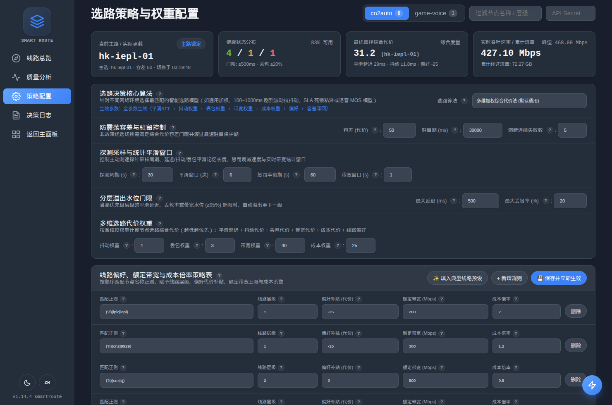
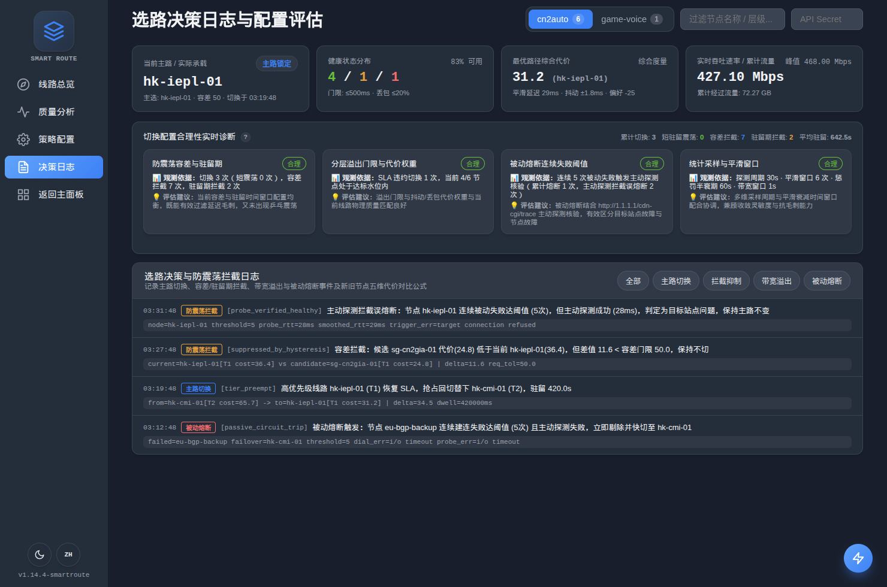

# SmartRoute Intelligent Proxy Routing (`package smartroute`)

`smartroute` is a **zero-invasion, self-contained intelligent routing extension package** built on top of upstream `sing-box`. It treats upstream `sing-box` purely as an imported library without modifying any tracked `sing-box` core source files.

---

## Web Console Preview (`/smartroute`)

### 1. Route Overview & Real-Time Path Cost Breakdown


### 2. Routing Algorithms, Smoothing Windows & Regex Policy Table


### 3. Configuration Assessment & Decision Audit Logs


---

## 1. Zero-Invasion Architecture & Seamless `sing-box` Upgrade

### SDK Integration (`smartroute.Context` & `smartroute.NewBox`)

```go
package main

import (
	"context"

	box "github.com/sagernet/sing-box"
	"github.com/sagernet/sing-box/option"
	"github.com/sagernet/sing-box/smartroute"
	"github.com/sagernet/sing/common/json"
)

func startSmartRouteBox(configBytes []byte) (*box.Box, error) {
	ctx := smartroute.Context(context.Background())
	options, err := json.UnmarshalExtendedContext[option.Options](ctx, configBytes)
	if err != nil {
		return nil, err
	}
	instance, err := smartroute.NewBox(box.Options{
		Context: ctx,
		Options: options,
	})
	if err != nil {
		return nil, err
	}
	return instance, instance.Start()
}
```

### Upgrading `sing-box` and Compiling Directly

Because zero upstream `sing-box` source files are modified:
```bash
# Pull upstream sing-box updates with zero merge conflicts
git pull origin main

# Build sing-box with SmartRoute extension (via cmd/sing-box/smartroute.go)
CGO_ENABLED=0 go build -tags "with_gvisor,with_quic,with_dhcp,with_wireguard,with_utls,with_acme,with_clash_api,with_tailscale" \
  -trimpath -ldflags "-s -w -buildid=" -o sing-box ./cmd/sing-box

# Or build the standalone entrypoint cmd/smartroute
CGO_ENABLED=0 go build -tags "with_gvisor,with_quic,with_dhcp,with_wireguard,with_utls,with_acme,with_clash_api,with_tailscale" \
  -trimpath -ldflags "-s -w -buildid=" -o smartroute ./cmd/smartroute
```

---

## 2. Configuration Structure

Both `"type": "urltest"` and `"type": "smartroute"` are supported:

```json
{
  "type": "urltest",
  "tag": "smart-auto",
  "algorithm": "composite",
  "outbounds": [
    "hk-iplc-01",
    "hk-cn2-01",
    "jp-9929-01",
    "sg-cmi-01",
    "us-bgp-01"
  ],
  "url": "http://1.1.1.1/cdn-cgi/trace",
  "interval": "30s",
  "idle_timeout": "30m",
  "interrupt_exist_connections": false,

  "tolerance": 50,
  "hold_time": "30s",
  "failure_threshold": 5,

  "stat_window": 6,
  "penalty_half_life": "60s",
  "bandwidth_window": "1s",

  "max_latency": 500,
  "max_loss": 0.20,

  "jitter_weight": 1.0,
  "loss_weight": 300.0,
  "bandwidth_weight": 40.0,
  "cost_weight": 25.0,

  "policies": [
    {
      "match": "(?i)(iplc|iepl)",
      "tier": 1,
      "preference": -25,
      "max_bandwidth_mbps": 100,
      "cost": 3.0
    },
    {
      "match": "(?i)(cn2|9929|cmin2)",
      "tier": 1,
      "preference": -15,
      "max_bandwidth_mbps": 300,
      "cost": 1.2
    },
    {
      "match": "(?i)(cmi|iij|softbank)",
      "tier": 2,
      "preference": 0,
      "max_bandwidth_mbps": 500,
      "cost": 0.8
    },
    {
      "match": ".*",
      "tier": 3,
      "preference": 10,
      "max_bandwidth_mbps": 1000,
      "cost": 0.2
    }
  ]
}
```

---

## 3. Built-in Routing Algorithms & Active Probe Circuit-Breaker Verification

### Routing Algorithms
- **`"composite"`** (*Default*): 5-dimensional weighted composite cost + hysteresis tolerance (all parameters active).
- **`"lcb_robust"`**: P95 Upper Confidence Bound tail latency + bilateral jitter-envelope adaptive hysteresis (`max(tolerance, 10%*cost, 1.25*(jitter_cur + jitter_cand))`), ideal when all routes fluctuate wildly between `100ms` and `1000ms`.
- **`"sticky_sla"`**: Strict SLA sticky lock — locks onto the current primary route as long as it remains within `max_latency` and `max_loss` (`tolerance` is ignored while within SLA).
- **`"mos_itu"`**: ITU-T G.107 E-Model MOS quality scoring with a `177.3ms` knee-point nonlinear impairment curve for VoIP/gaming.
- **`"lowest_rtt"`**: Pure smoothed RTT + preference priority (`jitter_weight` and `cost_weight` are ignored).

### 1-RTT Probe & Active Probe Verification Before Circuit Break (`failure_threshold`)
- **Default 1-RTT Probe URL (`http://1.1.1.1/cdn-cgi/trace`)**: Uses a pure Anycast IP over plaintext HTTP `HEAD`—eliminating upstream DNS resolution overhead and target TLS handshake overhead while ensuring true end-to-end 1-RTT verification across lazy-handshake (`NeedHandshakeForWrite`) and multiplexed/QUIC proxies.
- **Preventing False Circuit Breaks Caused by Dead Target Sites**: When consecutive passive dial failures on a node reach `failure_threshold`:
  1. **Zero-Wait Backup Retry**: The current connection request immediately retries via the best healthy alternate outbound (`selectAlternateOutbound`) without blocking user traffic.
  2. **Single-Flight Active Probe Adjudication**: Concurrently, `smartroute` triggers a single-flight active probe (`urltest.URLTest`) against the node:
     - **Probe Succeeds**: Proves the proxy node itself is healthy and the dial failures were caused by an unreachable target site. `smartroute` refunds the accumulated passive penalty, resets `ConsecutivePassiveFailures = 0`, updates smoothed RTT, and keeps the primary route unchanged (`probe_verified_healthy`).
     - **Probe Fails**: Confirms the proxy node is down, trips the circuit breaker (`CircuitOpen = true`), applies the circuit-trip penalty, and switches the primary route (`passive_circuit_trip`).

---

## 4. Web Console & RESTful API

When `experimental.clash_api` is enabled:
- **Web Dashboard**: `http://<external_controller>/smartroute`
- **RESTful Endpoints**:
  - `GET /smartroute/api/overview`
  - `PUT /smartroute/api/groups/{group}/config`
  - `POST /smartroute/api/groups/{group}/probe`
  - `POST /smartroute/api/nodes/{node}/probe`
  - `POST /smartroute/api/nodes/{node}/reset`
