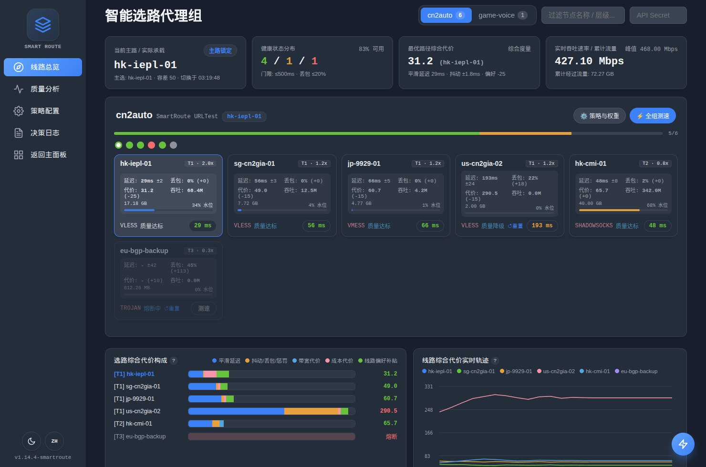
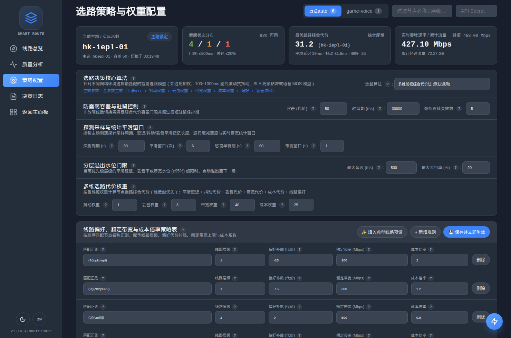
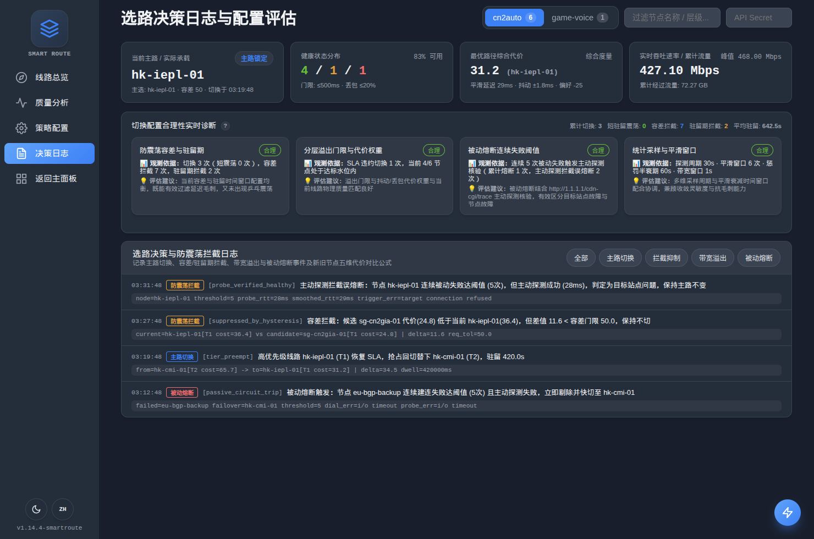

# SmartRoute 智能选路与线路质量管理 (`package smartroute`)

`smartroute` 是基于原版 `sing-box` 构建的**零侵入独立智能选路扩展包**。它将原版 `sing-box` 作为纯引用库（Library Dependency），在不修改任何一行原版 `sing-box` 核心源码的前提下，通过 `sing-box` 的 `context` 服务注册表与 `experimental` 钩子动态接管 `"urltest"` 与 `"smartroute"` 出站组，并在 `clash_api` 端口挂载可视化控制台 `/smartroute`。

---

## 界面预览 (`/smartroute`)

### 1. 线路总览与多维代价实时分析


### 2. 五大选路算法、统计窗口与正则策略配置


### 3. 切换合理性实时诊断与防震荡决策审计日志


---

## 一、架构设计与 `sing-box` 版本无缝升级指南

### 1. 零侵入扩展架构
```text
smartroute/
├── context.go          # 注入 OutboundRegistry 与 MetricsStorage，提供 smartroute.Context() / smartroute.NewBox()
├── options.go          # 独立定义 URLTestOptions 与 URLTestPolicy，注册 "urltest" 与 "smartroute" 出站类型
├── urltest.go          # URLTest 出站组与 routedOutbound 拨号包装器（拦截被动延迟、实时带宽与快速熔断重拨）
├── smartroute.go       # 5 大智能选路算法、Tier SLA 溢出、防震荡滞回与在线热更新引擎
├── metrics.go          # EWMA 延迟/抖动/丢包平滑、惩罚半衰期衰减与滑动窗口吞吐量统计（桥接上游 HistoryStorage）
├── clashapi.go         # 包装上游 clashapi.NewServer，复用同一端口挂载 /smartroute 控制台与 /smartroute/api/*
├── smartroute_ui.html  # 内嵌单文件可视化控制台（中英双语、暗色/亮色主题、算法动态联动与配置诊断）
└── *_test.go           # 完整单元测试与集成测试
```

### 2. 作为 Go 引用包接入方式（SDK 调用）
在自定义程序或独立仓库中将 `github.com/sagernet/sing-box` 作为依赖引用时，只需使用 `smartroute.Context(ctx)` 或 `smartroute.NewBox(options)`：

```go
package main

import (
	"context"

	box "github.com/sagernet/sing-box"
	"github.com/sagernet/sing-box/option"
	"github.com/sagernet/sing-box/smartroute"
	"github.com/sagernet/sing/common/json"
)

func startSmartRouteBox(configBytes []byte) (*box.Box, error) {
	// 1. 注入 smartroute 上下文（自动注册 "urltest" / "smartroute" 出站与 MetricsStorage）
	ctx := smartroute.Context(context.Background())

	// 2. 反序列化配置（自动识别 urltest/smartroute 下的 algorithm、policies 等扩展字段）
	options, err := json.UnmarshalExtendedContext[option.Options](ctx, configBytes)
	if err != nil {
		return nil, err
	}

	// 3. 创建并启动实例
	instance, err := smartroute.NewBox(box.Options{
		Context: ctx,
		Options: options,
	})
	if err != nil {
		return nil, err
	}
	return instance, instance.Start()
}
```

### 3. 原版 `sing-box` 版本更新与直接编译流程

由于未修改原版 `sing-box` 任何受版本控制的文件：

#### 方式 A：在当前仓库直接拉取上游更新并编译
```bash
# 1. 直接拉取官方上游最新代码（零合并冲突）
git pull origin main

# 2. 编译带 SmartRoute 扩展的 sing-box（通过 cmd/sing-box/smartroute.go 自动挂载）
CGO_ENABLED=0 go build -tags "with_gvisor,with_quic,with_dhcp,with_wireguard,with_utls,with_acme,with_clash_api,with_tailscale" \
  -trimpath -ldflags "-s -w -buildid=" -o sing-box ./cmd/sing-box

# 或编译独立入口 cmd/smartroute
CGO_ENABLED=0 go build -tags "with_gvisor,with_quic,with_dhcp,with_wireguard,with_utls,with_acme,with_clash_api,with_tailscale" \
  -trimpath -ldflags "-s -w -buildid=" -o smartroute ./cmd/smartroute
```

#### 方式 B：在独立 Go Module 项目中升级 `sing-box` 版本
```bash
# 升级 go.mod 中的 sing-box 版本并直接编译
go get -u github.com/sagernet/sing-box@latest
go mod tidy
go build -tags "with_gvisor,with_quic,with_dhcp,with_wireguard,with_utls,with_acme,with_clash_api,with_tailscale" ./cmd/smartroute
```

---

## 二、完整配置结构

`type` 同时支持设为 `"urltest"`（100% 兼容现有配置与客户端规则）或 `"smartroute"`：

```json
{
  "type": "urltest",
  "tag": "smart-auto",
  "algorithm": "composite",
  "outbounds": [
    "hk-iplc-01",
    "hk-cn2-01",
    "jp-9929-01",
    "sg-cmi-01",
    "us-bgp-01"
  ],
  "url": "http://1.1.1.1/cdn-cgi/trace",
  "interval": "30s",
  "idle_timeout": "30m",
  "interrupt_exist_connections": false,

  "tolerance": 50,
  "hold_time": "30s",
  "failure_threshold": 5,

  "stat_window": 6,
  "penalty_half_life": "60s",
  "bandwidth_window": "1s",

  "max_latency": 500,
  "max_loss": 0.20,

  "jitter_weight": 1.0,
  "loss_weight": 300.0,
  "bandwidth_weight": 40.0,
  "cost_weight": 25.0,

  "policies": [
    {
      "match": "(?i)(iplc|iepl|专线)",
      "tier": 1,
      "preference": -25,
      "max_bandwidth_mbps": 100,
      "cost": 3.0
    },
    {
      "match": "(?i)(cn2|9929|cmin2)",
      "tier": 1,
      "preference": -15,
      "max_bandwidth_mbps": 300,
      "cost": 1.2
    },
    {
      "match": "(?i)(cmi|iij|softbank|软银)",
      "tier": 2,
      "preference": 0,
      "max_bandwidth_mbps": 500,
      "cost": 0.8
    },
    {
      "match": ".*",
      "tier": 3,
      "preference": 10,
      "max_bandwidth_mbps": 1000,
      "cost": 0.2
    }
  ]
}
```

---

## 三、核心选路模型与五大内置算法

### 1. 选路综合代价公式 (`composite` 默认算法)
每个健康节点的 **选路综合代价 (`Cost`)** 越低越优先（基准：`1ms 平滑延迟 = 1 代价单位`）：

$$
\text{Cost} = \underbrace{\text{RTT}_ {\text{smooth}}}_ {\text{基础平滑延迟}} + \underbrace{\text{Jitter} \times W_ {\text{jitter}} + \text{LossRate} \times W_ {\text{loss}} + \text{Penalty}(t)}_ {\text{SLA 抖动/丢包/历史震荡惩罚代价}} + \underbrace{\text{BWPenalty}}_ {\text{带宽拥塞代价}} + \underbrace{(\text{CostRatio} - 1.0) \times W_ {\text{cost}}}_ {\text{流量成本代价}} + \underbrace{\text{Preference}}_ {\text{线路偏好补贴}}
$$

* **带宽拥塞代价 (`BWPenalty`)**：
  当节点配置了 `max_bandwidth_mbps > 0` 且实时带宽水位 $U = \frac{\text{Throughput}}{\text{MaxBandwidth}} > 0.60$ （即超过 `60%`）时，按非线性曲线累加拥塞代价：

$$\text{BWPenalty} = W_ {\text{bw}} \times \frac{U - 0.60}{1.0 - U} \quad (0.60 < U < 0.95)$$

  当带宽水位达到 $U \ge 0.95$ （即 `95%`）时标记为满载，**新发起的连接将自动无损溢出（Spillover）至次优空闲线路，且绝不中断当前主路已建立的存量连接**。

### 2. 两阶段选路决策流程与被动熔断主动核验
1. **第一阶段（Tier 分层 SLA 过滤与跨层溢出）**：
   * 节点满足 SLA 的条件：平滑延迟 $\text{RTT}_ {\text{smooth}} \le \text{RTT}_ {\max}$ （`max_latency`）、丢包率 $\text{LossRate} \le \text{Loss}_ {\max}$ （`max_loss`），且实时带宽水位 $< 95\%$ 。
   * 系统优先在 **最高优先级层级**（最小 `tier` 数字，如 `Tier 1`）中筛选满足 SLA 的节点；只要 `Tier 1` 存在至少 1 个达标节点，`Tier 2/3` 即使物理延迟更低也绝不抢占。
   * 仅当 `Tier 1` 所有节点均超出 SLA 门限或满载时，流量才自动溢出至 `Tier 2`。
2. **第二阶段（同层综合代价择优 + 防震荡滞回与驻留保护）**：
   * 在同一层级内，对比候选节点与当前主路的综合代价差 $\Delta = \text{Cost}_ {\text{current}} - \text{Cost}_ {\text{candidate}}$ 。
   * 必须同时满足以下两个条件才执行切换：
     1. **滞回容差门限**： $\Delta > \max(\text{Tolerance},\ 0.10 \times \text{Cost}_ {\text{current}})$ （即大于 `tolerance` 与当前主路总代价的 `10%`）
     2. **最短驻留保护期**：距上次切换时间 $\Delta t_ {\text{hold}} \ge T_ {\text{hold}}$ （`hold_time`）
3. **被动熔断与主动探测防误杀机制（`failure_threshold`）**：
   * **被动业务流量双轨核验**：当实际业务流量通过当前主路连续建连失败达到 `failure_threshold` 次时，采取 **「当前请求零等待借道备路 + 单飞主动探测裁决」**：
     1. **业务请求零等待重试**：当前触发阈值的这笔连接请求立即通过 `selectAlternateOutbound` 借道次优健康备路重拨，不阻塞用户当前连接。
     2. **主动探测区分“节点故障”与“目标站点故障”**：后台立即对该节点发起 1 次针对测速 `url`（默认 `http://1.1.1.1/cdn-cgi/trace`，3s 超时，单飞去重）的主动探测：
        * **若主动探测成功**：证明「本地 $\leftrightarrow$ 代理节点 $\leftrightarrow$ 外部网络」完全正常，此前连续失败是由 **目标站点自身不可达** 引起。系统立即清零该节点的连续被动失败计数、退还累积被动惩罚、刷新平滑 RTT，并保持原主路不变（记录 `probe_verified_healthy` 事件，拒绝误熔断）。
        * **若主动探测失败**：实锤代理节点自身故障，立即正式打开熔断开关（`CircuitOpen = true`）、记入 `+100` 熔断惩罚分并触发主路切换（记录 `passive_circuit_trip` 事件）。
   * **主动探针快速复核与带伤降权（防单次丢包误下线）**：
     1. **即时快速重试（Retry-Once）**：对当前在线（`Available = true`）的节点，若周期性或手动主动探针首次超时失败，会立即自动发起 1 次快速复核探测（3s 超时），过滤偶发单包丢失。
     2. **单轮失败带伤降权、连续失败下线**：对于已有成功样本（`sample_count > 0`）的在线节点，首次探测失败**不会直接判定为离线（`available = false`）**，而是保留在线状态并累加 **EWMA 丢包率 (`loss_rate`) + 探针惩罚代价 (`+50`)** 进行平滑降权；仅当**连续 2 轮**主动探测（含自动重试）均失败时，才正式判定为离线并清除历史延迟。
4. **`cache.db` 热数据持久化与防膨胀设计**：
   * **零冷启动盲选**：自动复用 `experimental.cache_file`（未显式开启时自动挂载默认 `cache.db`），服务重启后秒级恢复各组锁定主路（`selected_tcp` / `selected_udp`）、在线策略配置及各节点热态代价指标（`smoothed_rtt`、`jitter`、`loss_rate`、`penalty` 按离线时长自动计算半衰期衰减、`effective_score`）。
   * **防膨胀机制（Anti-Bloat）**：
     1. **单组单 Key 覆盖写入（`__sr__:<groupTag>`）**：不按节点拆分独立 Key，订阅更新或节点改名/下线时自动剔除旧节点，杜绝孤儿 Key 堆积。
     2. **极简热数据编码与边界控制**：`score_history`（UI 实时轨迹）仅驻留内存不落盘；仅导出 **24 小时 TTL** 内的活跃热节点（单组上限 64 个，约 `45 Bytes/节点`），单组记录稳定控制在 `1~2 KB`（单个 4KB bbolt 页内）。
     3. **写操作限流合并（Write Coalescing）与退出刷盘**：Web 控制台高频只读轮询（`/smartroute/api/overview`）**零磁盘写入**；仅在首次获取热数据、主路发生切换、手动保存配置、距上次刷盘满 `60s` 或服务退出（`Close()`）时落盘。

### 3. 五大内置选路算法与参数支持矩阵

可通过 `"algorithm"` 字段（或在 `/smartroute` 网页控制台顶部下拉框）切换以下 5 种工业级智能选路算法：

| 算法标识 (`algorithm`) | 算法名称 | 数学模型与核心机制 | 最适用场景 |
| :--- | :--- | :--- | :--- |
| **`composite`**<br>*(默认)* | **多维加权综合代价法**<br>*(Weighted Composite Cost)* | **线性五维叠加 + 固定/相对容差滞回**：<br> $\text{Cost} = \text{RTT} + \text{Jitter}\cdot W_ {\text{jit}} + \text{Loss}\cdot W_ {\text{loss}} + \text{Penalty} + \text{BW} + \text{Cost} + \text{Pref}$ | **通用均衡场景**：适合专线/精品网/直连混合调度。 |
| **`lcb_robust`** | **置信上界抗波动法**<br>*(UCB Tail + Bilateral Jitter Envelope)* | **1. P95 悲观置信上界 + 样本不确定性 + 丢包非线性阻尼**：<br> $\text{RTT}_ {\text{eff}} = \frac{\text{RTT} + 1.65 \cdot W_ {\text{jit}} \cdot \text{Jitter} \cdot (1 + 1/\sqrt{N})}{(1 - \text{LossRate})^2}$ <br>**2. 双边抖动包络自适应滞回（Welch's t-test 思想）**：<br> $\text{Hysteresis} = \max\big(\text{Tolerance},\ 0.10\cdot\text{Cost},\ 1.25 \times (\text{Jitter}_ {\text{cur}} + \text{Jitter}_ {\text{cand}})\big)$ | **各线路均不稳定（如全员 100~1000ms 剧烈波动）**：<br>自动利用主备双边抖动之和抬升切换门槛，无需手调超大容差即可过滤随机波峰波谷相位差。 |
| **`sticky_sla`** | **SLA 粘滞死锁法**<br>*(Strict SLA Sticky Lock)* | **“不破红线绝不切换”**：<br>只要当前承载主路健康、未满载且满足 SLA 门限（ $\text{RTT} \le \text{RTT}_ {\max}$ 且 $\text{Loss} \le \text{Loss}_ {\max}$ ），同层级内完全忽略其他节点的低延迟诱惑，死锁当前主路；仅在违约、熔断或满载时重选最优备路。 | **极端防抖 / 防出口 IP 变动场景**：<br>如 SSH 终端、远程桌面、金融/开发长连接，或“只要当前线路能用就绝不折腾”。 |
| **`mos_itu`** | **ITU-T G.107 实时交互法**<br>*(E-Model MOS Quality)* | **177.3ms 语音延迟拐点非线性模型**：<br>• 有效缓冲延迟 $d_ {\text{eff}} = \text{RTT} + 2 \cdot W_ {\text{jit}} \cdot \text{Jitter}$ ；<br>• 当 $d_ {\text{eff}} > 177.3\text{ms}$ 时触发非线性陡增惩罚 $(d_ {\text{eff}} - 177.3)\times 1.8$ ；<br>• 丢包采用突发非线性损耗函数 $\frac{\text{Loss}}{\text{Loss} + 0.08}$ 。 | **实时语音 (VoIP) / 视频会议 / 竞技游戏**：<br>严守 `177ms` 交互体验红线与零丢包要求。 |
| **`lowest_rtt`** | **经典极简延迟优先法**<br>*(Pure Smoothed RTT)* | 仅比较层级 (`Tier`)、平滑延迟 (`SmoothedRTT`)、线路偏好补贴 (`Preference`) 与断连惩罚，忽略抖动与资费成本倍率。 | **传统极简测速场景**：保持纯延迟选路习惯，同时具备 EWMA 平滑与被动熔断能力。 |

#### 各算法差异化参数支持矩阵
（在 `/smartroute` 网页控制台切换算法时，当前算法不使用的参数会自动置灰禁用）：

| 参数项 | `composite`<br>多维加权综合代价 | `lcb_robust`<br>置信上界抗波动 | `sticky_sla`<br>SLA 粘滞死锁 | `mos_itu`<br>ITU-T 实时交互 | `lowest_rtt`<br>极简延迟优先 |
| :--- | :---: | :---: | :---: | :---: | :---: |
| **`tolerance`<br>容差 (代价)** | ✅ **线性滞回生效**<br> $\max(\text{Tolerance}, 0.10\cdot\text{Cost})$ | ⚡ **作为保底容差**<br>自动取 $\max(\text{Tolerance}, 0.10\cdot\text{Cost}, 1.25\times(\text{Jit}_ {\text{cur}}+\text{Jit}_ {\text{cand}}))$ | ❌ **不生效 (自动置灰)**<br>主路满足 SLA 期间死锁不切 | ✅ **生效** | ✅ **生效** |
| **`jitter_weight`<br>抖动权重** | ✅ **线性加权**<br> $\text{Jitter} \times W_ {\text{jit}}$ | ⚡ **P95 置信上界调节**<br> $1.65 \cdot W_ {\text{jit}} \cdot \text{Jitter} \cdot (1+\frac{1}{\sqrt{N}})$ | ✅ **仅重选备路时生效** | ⚡ **缓冲延迟加权**<br>超 `177.3ms` 陡增惩罚 | ❌ **不生效 (自动置灰)**<br>完全忽略抖动 |
| **`loss_weight`<br>丢包权重** | ✅ **线性加权**<br> $\text{Loss} \times W_ {\text{loss}}$ | ⚡ **双重惩罚**<br>线性项 + $\frac{1}{(1-\text{Loss})^2}$ 分母放大 | ✅ **仅重选备路时生效** | ⚡ **突发丢包非线性曲线**<br> $W_ {\text{loss}} \cdot \frac{\text{Loss}}{\text{Loss}+0.08}\cdot 1.5$ | ⚡ **半权轻量惩罚**<br> $0.5 \times \text{Loss} \times W_ {\text{loss}}$ |
| **`bandwidth_weight`<br>带宽权重** | ✅ **生效** | ✅ **生效** | ✅ **生效**（满载 95% 仍触发溢出） | ✅ **生效** | ✅ **生效** |
| **`cost_weight` & `cost`<br>成本权重与倍率** | ✅ **生效** | ✅ **生效** | ✅ **仅重选备路时生效** | ✅ **生效** | ❌ **不生效 (自动置灰)**<br>完全忽略资费成本 |

---

## 四、字段详细说明

### 1. 基础测速字段

| 字段名 | 类型 | 默认值 | 说明 |
| :--- | :--- | :---: | :--- |
| `type` | `string` | `"urltest"` | 支持 `"urltest"` 或 `"smartroute"`。 |
| `outbounds` | `[]string` | **必填** | 参与测速与选路的出站节点标签列表。 |
| `algorithm` | `string` | `"composite"` | 选路核心算法，可选：`"composite"`、`"lcb_robust"`、`"sticky_sla"`、`"mos_itu"`、`"lowest_rtt"`。 |
| `url` | `string` | `http://1.1.1.1/cdn-cgi/trace` | 主动探针测速目标 URL（默认采用纯 IP + HTTP 明文，无需 DNS 解析与目标 TLS 握手，1-RTT 完成端到端探测）。 |
| `interval` | `Duration` | `"30s"` | 主动并发测速探针的执行周期。如 `"10s"`、`"30s"`、`"1m"`。 |
| `idle_timeout` | `Duration` | `"30m"` | 无业务流量经过时的探针休眠超时时间（必须 $\ge$ `interval`）。 |
| `interrupt_exist_connections` | `bool` | `false` | 当主路发生切换时是否强制断开已建立的外部连接（注：带宽满载触发的无损溢出永远不会中断已有连接）。 |

### 2. 防震荡容差、驻留与被动熔断字段

| 字段名 | 类型 | 默认值 | 说明 |
| :--- | :--- | :---: | :--- |
| `tolerance` | `uint16` | `50` | **同级切换容差（单位：代价）**。同层级内非故障切换所需的最小综合代价优势，实际生效门限为 $\max(\text{Tolerance},\ 0.10 \times \text{Cost}_ {\text{current}})$ 。 |
| `hold_time` | `Duration` | `"30s"` | **最短驻留保护期**。主路切换后必须稳定驻留满该时长才允许再次发生非故障择优切换，防止延迟毛刺引发乒乓回切。 |
| `failure_threshold` | `uint8` | `5` | **被动熔断连续失败阈值**。当实际业务流量连续建连失败达到该次数时，当前请求立即零等待借道备路重拨，同时对该节点发起单飞主动探测：探测失败则正式触发节点熔断并切主；探测成功则判定为目标站点问题，自动清零计数并保持原主路不变。 |

### 3. 统计采样与平滑衰减窗口字段

| 字段名 | 类型 | 默认值 | 说明 |
| :--- | :--- | :---: | :--- |
| `stat_window` | `uint8` | `6` | **质量平滑窗口（单位：采样次数 $N$ ，范围 `1~50`）**。自动折算 EWMA 指数平滑系数： $\alpha_ {\text{RTT}}=\frac{2}{N+1},\ \beta_ {\text{Jitter}}=\frac{2}{N+2},\ \gamma_ {\text{Loss}}=\frac{2}{N+4}$ 。设为 `1` 表示不平滑；设为 `10~16` 可强力过滤偶发毛刺。 |
| `penalty_half_life` | `Duration` | `"60s"` | **历史惩罚衰减半衰期**。节点发生探针超时（`+50` 代价）或被动熔断（`+100` 代价）后，其惩罚分衰减 50% 所需的时间（ $\text{Penalty}(t) = \text{Penalty}_ {0} \times 0.5^{\Delta t / T_ {1/2}}$ ）。 |
| `bandwidth_window` | `Duration` | `"1s"` | **带宽速率滑动统计窗口（范围 `"1s" ~ "30s"`）**。设为 `"1s"` 可对瞬时满载实现秒级溢出；设为 `"3s" ~ "10s"` 可平滑网页加载等短时突发（Micro-burst），仅在持续高吞吐时触发带宽惩罚与溢出。 |

### 4. 分层 SLA 溢出水位门限与多维权重字段

| 字段名 | 类型 | 默认值 | 说明 |
| :--- | :--- | :---: | :--- |
| `max_latency` | `uint16` | `500` | **SLA 最大平滑延迟门限（单位：`ms`）**。高优先级 Tier 节点平滑延迟超过此值时视为 SLA 降级，允许溢出至下一级 Tier。 |
| `max_loss` | `float64` | `0.20` | **SLA 最大探测丢包率门限（范围 `0 ~ 1.0`，`0.20` 即 `20%`）**。在默认 $N=6$ 窗口下，单次偶发超时恢复后的残留丢包率为 `16% <= 20%`（立即恢复达标），连续 2 次超时（`36% > 20%`）才判定为 SLA 违约。 |
| `jitter_weight` | `float64` | `1.0` | **抖动权重（代价 / 1ms 抖动）**。默认 `1.0` 表示每 `1ms` 抖动增加 `1.0` 点综合代价。 |
| `loss_weight` | `float64` | `300.0` | **丢包权重（代价 / 100% 丢包）**。JSON 中 `300.0` 对应每 **1% 丢包增加 `3.0` 点代价**（Web UI 面板中直接以“每 1% 丢包代价 `3.0`”展示）。 |
| `bandwidth_weight` | `float64` | `40.0` | **带宽拥塞权重**。当节点实时吞吐超过额定带宽 `60%` 时，按 $W_ {\text{bw}} \times \frac{U-0.6}{1-U}$ 累加代价。 |
| `cost_weight` | `float64` | `25.0` | **流量成本权重**。将策略表中的成本倍率折算为选路代价： $(\text{CostRatio} - 1.0) \times W_ {\text{cost}}$ 。 |

### 5. 线路策略表 (`policies`) 子字段

`policies` 数组按 **从上到下顺序匹配** 节点标签 `tag`（命中第一条即生效，未命中的节点默认使用 `tier=1, preference=0, max_bandwidth_mbps=0, cost=1.0`）：

| 字段名 | 类型 | 默认值 | 说明 |
| :--- | :--- | :---: | :--- |
| `match` | `string` | `".*"` | 节点名称正则表达式（支持 `(?i)` 忽略大小写，如 `"(?i)(iplc\|iepl)"`）。 |
| `tier` | `int` | `1` | **线路优先级层级（`1` 为最高优先级）**。数字越小层级越高，高层级有达标节点时严格屏蔽低层级。 |
| `preference` | `int` | `0` | **线路偏好代价补贴（单位：代价）**。负数代表优质线路补贴（直接扣减综合代价，优先选中），正数代表劣质线路附加惩罚。 |
| `max_bandwidth_mbps` | `uint32` | `0` | **线路额定最大带宽（单位：`Mbps`）**。设为 `0` 表示不限制带宽水位；设为实际带宽（如 `100`、`300`）可启用拥塞加权与 `95%` 满载无损溢出。 |
| `cost` | `float64` | `1.0` | **流量成本倍率（`1.0` 为基准）**。如昂贵按量专线设为 `3.0`，廉价大流量线路设为 `0.3`。 |

---

## 五、典型实战配置示例

### 场景一：游戏 / 语音会议低抖动优先（`mos_itu` 算法）
```json
{
  "type": "urltest",
  "tag": "game-smart",
  "algorithm": "mos_itu",
  "outbounds": ["hk-iepl-01", "hk-iepl-02", "tw-cn2-01", "jp-9929-01"],
  "url": "http://1.1.1.1/cdn-cgi/trace",
  "interval": "10s",
  "stat_window": 8,
  "penalty_half_life": "90s",
  "tolerance": 25,
  "hold_time": "20s",
  "failure_threshold": 3,
  "max_latency": 200,
  "max_loss": 0.10,
  "jitter_weight": 3.0,
  "loss_weight": 600.0,
  "cost_weight": 5.0,
  "policies": [
    { "match": "(?i)(iepl|iplc)", "tier": 1, "preference": -20, "cost": 1.0 },
    { "match": ".*", "tier": 1, "preference": 0, "cost": 1.0 }
  ]
}
```

### 场景二：主备严格分层 + 大流量下载溢出分流（`composite` 算法）
```json
{
  "type": "urltest",
  "tag": "hybrid-smart",
  "algorithm": "composite",
  "outbounds": ["hk-iplc-100m", "sg-cn2-300m", "hk-cmi-1000m", "us-bgp-1000m"],
  "interval": "30s",
  "stat_window": 6,
  "bandwidth_window": "3s",
  "tolerance": 50,
  "hold_time": "30s",
  "max_latency": 350,
  "max_loss": 0.20,
  "bandwidth_weight": 50.0,
  "cost_weight": 30.0,
  "policies": [
    { "match": "(?i)iplc", "tier": 1, "preference": -25, "max_bandwidth_mbps": 100, "cost": 2.5 },
    { "match": "(?i)cn2", "tier": 1, "preference": -10, "max_bandwidth_mbps": 300, "cost": 1.2 },
    { "match": "(?i)cmi", "tier": 2, "preference": 0, "max_bandwidth_mbps": 1000, "cost": 0.5 },
    { "match": ".*", "tier": 3, "preference": 15, "max_bandwidth_mbps": 1000, "cost": 0.2 }
  ]
}
```

### 场景三：高稳定性防抖优先 / 不破红线绝不切路（`sticky_sla` 算法）
```json
{
  "type": "urltest",
  "tag": "stable-transoceanic",
  "algorithm": "sticky_sla",
  "outbounds": ["us-cn2gia-01", "us-9929-01", "jp-cn2-01"],
  "interval": "30s",
  "stat_window": 12,
  "penalty_half_life": "120s",
  "hold_time": "60s",
  "failure_threshold": 5,
  "max_latency": 600,
  "max_loss": 0.25
}
```

### 场景四：各线路均不稳定（全员 RTT 在 100ms ~ 1000ms 间剧烈波动，`lcb_robust` 算法）
```json
{
  "type": "urltest",
  "tag": "extreme-unstable-smart",
  "algorithm": "lcb_robust",
  "outbounds": ["line-a", "line-b", "line-c", "line-d"],
  "url": "http://1.1.1.1/cdn-cgi/trace",
  "interval": "15s",
  "stat_window": 16,
  "penalty_half_life": "180s",
  "bandwidth_window": "5s",
  "tolerance": 300,
  "hold_time": "90s",
  "failure_threshold": 6,
  "max_latency": 900,
  "max_loss": 0.30,
  "jitter_weight": 0.5,
  "loss_weight": 450.0,
  "bandwidth_weight": 40.0,
  "cost_weight": 20.0
}
```

---

## 六、可视化管理与 RESTful API 接口

当启用 `experimental.clash_api` 后，可直接通过浏览器访问内置的 **SmartRoute 智能选路控制台**：

* **Web 控制台地址**：`http://<external_controller>/smartroute`
* **RESTful API 端点**：
  * `GET /smartroute/api/overview`：获取所有 `urltest` / `smartroute` 组的节点实时指标、综合代价拆解、决策日志与配置诊断报告；
  * `PUT /smartroute/api/groups/{group}/config`：在线热更新指定组的选路算法、参数、统计窗口与策略表；
  * `POST /smartroute/api/groups/{group}/probe`：立即触发指定组并发探针测速；
  * `POST /smartroute/api/nodes/{node}/probe`：单独对某个节点发起即时测速；
  * `POST /smartroute/api/nodes/{node}/reset`：手动清零指定节点的历史惩罚分并解除被动熔断状态。
